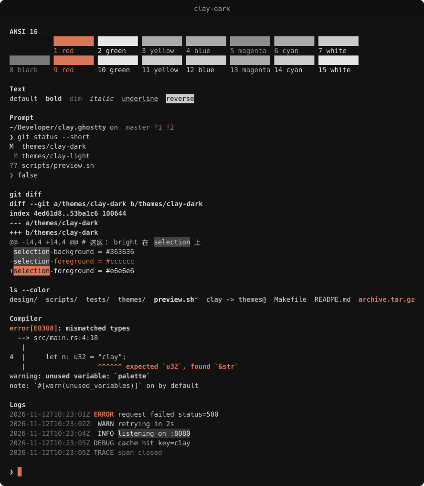
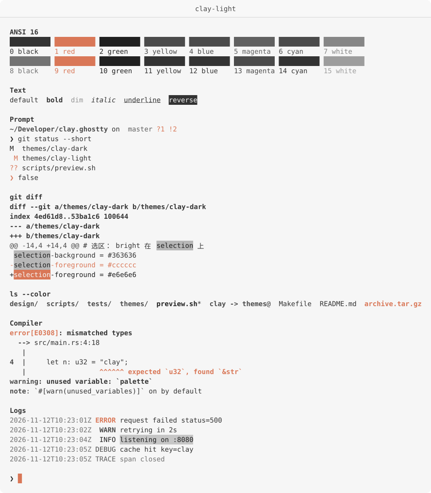

# clay.ghostty

灰阶为底，陶土色点睛的 [Ghostty](https://ghostty.org) 主题，提供暗色与亮色两个变体。





除 Clay `#D97757` 外，所有颜色都是 R = G = B 的中性灰：层级靠亮度表达，而不是色相。Clay 只标记焦点，即光标、当前搜索匹配和 ANSI red。暗色背景为 `#121212`，亮色为 `#F6F6F6`。亮色是暗色的镜像而非反相：每一档文字与底色的对比度和暗色相同，表面朝相反方向叠加。

需要 **Ghostty 1.3+**。更早的版本不认识 `search-*` 键，会报 unknown field。

## 安装

```sh
make install
```

主题会复制到 `$XDG_CONFIG_HOME/ghostty/themes`（默认 `~/.config/ghostty/themes`），可用 `GHOSTTY_THEMES=/path make install` 指定其他目录；`make uninstall` 删除。也可以手动复制 `themes/` 下的两个文件。

在 Ghostty 配置中选择变体：

```ini
theme = clay-dark
```

或者跟随系统明暗自动切换：

```ini
theme = light:clay-light,dark:clay-dark
```

修改后用 `reload_config`（Linux 默认 <kbd>Ctrl</kbd>+<kbd>Shift</kbd>+<kbd>,</kbd>）重新加载。配置文件里另外设置的颜色会覆盖主题。

## 可选设置

主题只设置颜色，以下由你决定：

```ini
# 透明背景，让桌面或合成器决定底色
background-opacity = 0.9

# 标题栏使用主题色（仅 GTK，主题已设置 window-titlebar-*）
window-theme = ghostty
```

## 配色

### 界面

| Ghostty 键                   | 角色        | 暗色      | 亮色      |
| ---------------------------- | ----------- | --------- | --------- |
| `background`                 | 底色 `bg`   | `#121212` | `#f6f6f6` |
| `foreground`                 | 正文 `fg`   | `#cccccc` | `#333333` |
| `cursor-color`               | `clay`      | `#d97757` | `#d97757` |
| `cursor-text`                | `bg`        | `#121212` | `#f6f6f6` |
| `selection-background`       | `selection` | `#363636` | `#c6c6c6` |
| `selection-foreground`       | `bright`    | `#e6e6e6` | `#202020` |
| `search-background`          | `search`    | `#424242` | `#b7b7b7` |
| `search-foreground`          | `bright`    | `#e6e6e6` | `#202020` |
| `search-selected-background` | `clay`      | `#d97757` | `#d97757` |
| `search-selected-foreground` | `bg`        | `#121212` | `#f6f6f6` |
| `split-divider-color`        | `border`    | `#2a2a2a` | `#d5d5d5` |
| `unfocused-split-fill`       | `bg`        | `#121212` | `#f6f6f6` |
| `window-titlebar-background` | `sidebar`   | `#101010` | `#f8f8f8` |
| `window-titlebar-foreground` | `secondary` | `#aaaaaa` | `#4b4b4b` |

未聚焦分屏用底色覆盖，让文字向底色褪去，效果接近注释档的弱化；若改用更深的阴影色，亮色变体的整块分屏会被压暗。

### ANSI 16 色

ANSI 颜色名是绝对颜色：两个变体中 black 都比 white 深。彩色槽位映射回灰阶，只有 red 用 Clay。red 和 green 都与正文色不同，错误输出和 diff 行不会混进正文。

| 序号 | 名称           | 暗色                  | 亮色                  |
| ---- | -------------- | --------------------- | --------------------- |
| 0    | black          | `sidebar` `#101010`   | `fg` `#333333`        |
| 1    | red            | `clay` `#d97757`      | `clay` `#d97757`      |
| 2    | green          | `bright` `#e6e6e6`    | `bright` `#202020`    |
| 3    | yellow         | `secondary` `#aaaaaa` | `secondary` `#4b4b4b` |
| 4    | blue           | `secondary` `#aaaaaa` | `secondary` `#4b4b4b` |
| 5    | magenta        | `muted` `#8e8e8e`     | `muted` `#616161`     |
| 6    | cyan           | `secondary` `#aaaaaa` | `secondary` `#4b4b4b` |
| 7    | white          | `fg` `#cccccc`        | `subtle` `#868686`    |
| 8    | bright black   | `comment` `#7a7a7a`   | `comment` `#737373`   |
| 9    | bright red     | `clay` `#d97757`      | `clay` `#d97757`      |
| 10   | bright green   | `bright` `#e6e6e6`    | `bright` `#202020`    |
| 11   | bright yellow  | `fg` `#cccccc`        | `fg` `#333333`        |
| 12   | bright blue    | `fg` `#cccccc`        | `fg` `#333333`        |
| 13   | bright magenta | `secondary` `#aaaaaa` | `secondary` `#4b4b4b` |
| 14   | bright cyan    | `fg` `#cccccc`        | `fg` `#333333`        |
| 15   | bright white   | `bright` `#e6e6e6`    | `gutter` `#9d9d9d`    |

文字档位与底色的 WCAG 对比度（暗色 / 亮色）：`bright` 15.0 / 15.1，`fg` 11.7 / 11.7，`secondary` 8.1 / 8.1，`muted` 5.7 / 5.7，`comment` 4.4 / 4.4。Clay 在暗色上为 6.0；亮色保持品牌色不变，对比度只有 2.9。

## 开发

- `make test`：按设计规则检查两个主题。检查内容包括：只用中性灰和 Clay；Clay 只出现在焦点槽位；正文对比度 ≥ 7、注释 ≥ 4；red/green 与正文不同、black 比 white 深；搜索比选区离底色更远；两个变体的文字对比度与表面距离互为镜像。找到 `ghostty` 时还会运行 `ghostty +validate-config`，找不到则记为 SKIP。
- `make preview`：在当前终端输出色板和常见输出（提示符、git diff、ls、编译错误、日志），用于在 Ghostty 中目测。
- `make images`：将 `make preview` 的输出按主题渲染为 `assets/*.svg`，图中额外画出标题栏、选区、搜索匹配和光标。

修改色值时同时更新两个变体，并运行 `make test` 与 `make images`。
